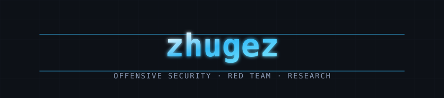
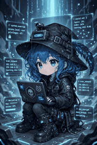

 

 

 

---

Working on **offensive security**: vulnerability research, red team operations, and security automation.  
Also into malware reverse engineering and applied ML for security.  
Open to collaborating on research and turning ideas into real open-source tools.

## Selected work

| Project | What it does |
| --- | --- |
| **[TrustSee](https://trustsee.com)** | CVE baseline (NVD/OSV/GHSA) ranked by KEV + EPSS. Posture checks, authorized probes, dark-web feed, MCP `scan_repo`. Next.js · TS |
| **[ExoMind](https://github.com/zhugez/ExoMind)** | Portable knowledge & memory runtime for Pi / Hermes / OpenClaw / Codex. Rust |
| **[Stella](https://github.com/zhugez/Stella)** | Illustrated IELTS vocab (7.3k words + audio + FSRS). [Live](https://stella.zhugez.workers.dev) |
| **[Pingloom](https://github.com/zhugez/Pingloom)** | Native desktop ping & emote wheels. Tauri 2 · Svelte 5 · Rust |
| **[Pi-pulse](https://github.com/zhugez/Pi-pulse)** | Extensions for the Pi coding agent (guards, diagnostics…). TS |
| **[Cordyceps](https://github.com/zhugez/Cordyceps)** | WordPress plugin scanner with AST reachability. Python |

## Tech stack

  

## Stats

  
  

  

## Latest blog posts

<!-- BLOG-POST-LIST:START -->
<!-- BLOG-POST-LIST:END -->

## Research & disclosures

**Publications** (first author): AISEI 2026 IEEE, SSRC 2026, APSIPA ASC 2026, ATC 2024.

**Disclosures**: Telegram Android (4 findings, incl. High), Patchstack (2 Medium, accepted), IUH (3, accepted).

**Awards**: YSC 2025 Consolation · Certified AppSec Practitioner (CAP).

## Contact

[Blog](https://shadowforge.vercel.app/) · [X](https://x.com/dezzhu1) · [LinkedIn](https://www.linkedin.com/in/dezzhu) · [dev.to](https://dev.to/zhugez)

Open to work.

<!--
Optional: add Spotify now-playing after setup at https://spotify-github-profile.kittinanx.com

-->
